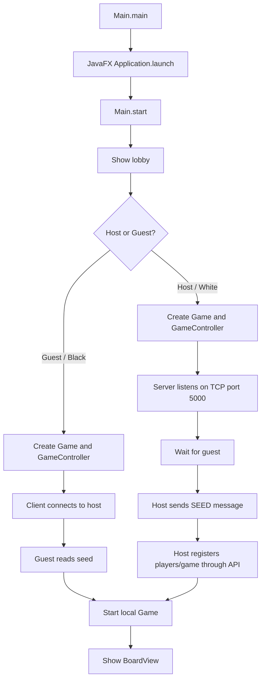
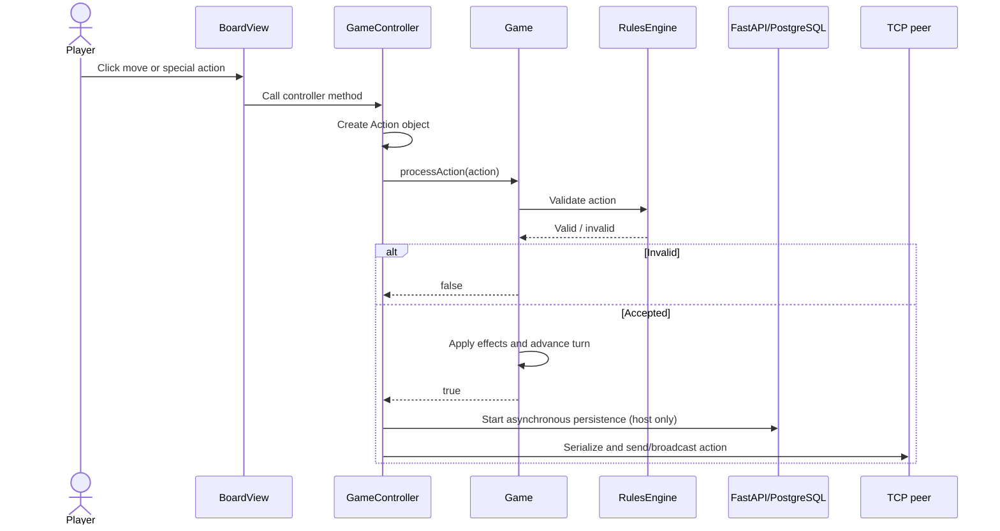
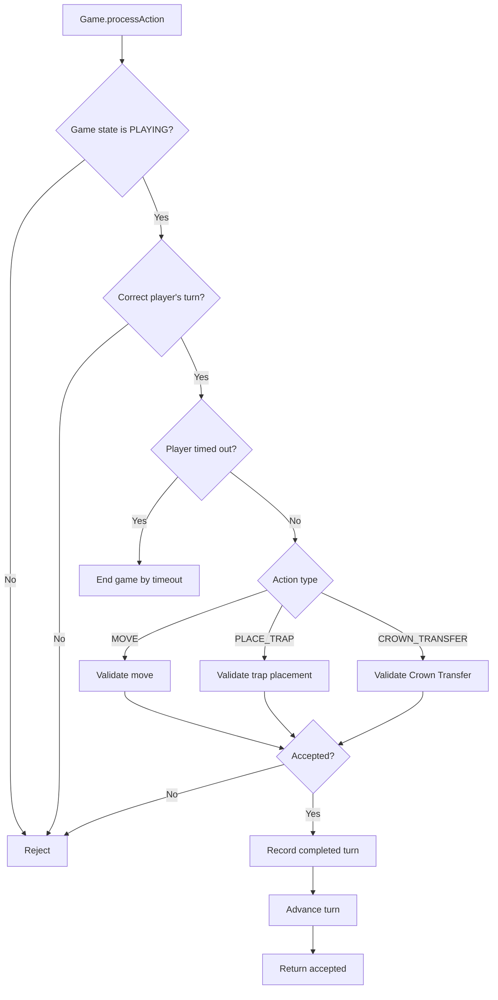
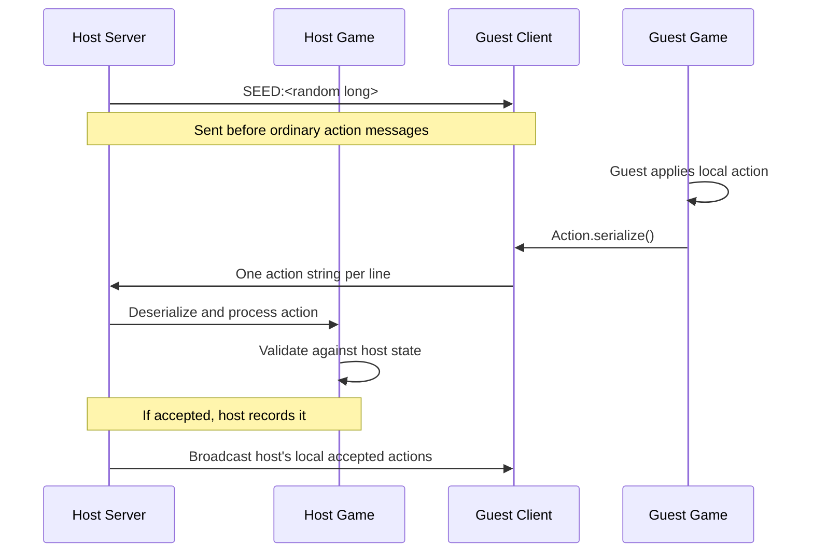
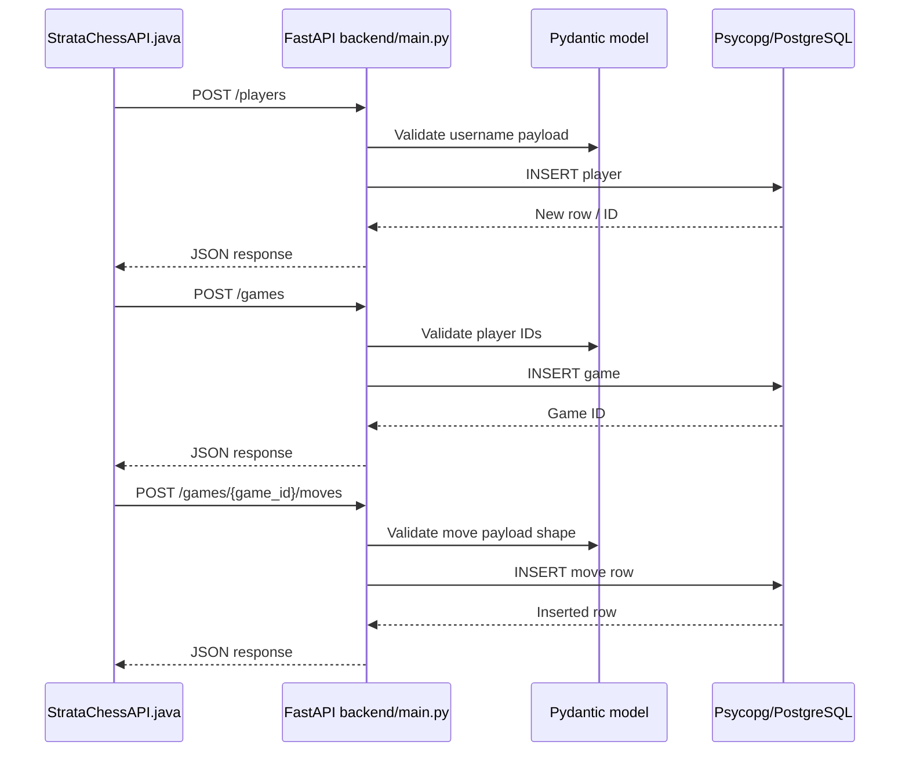

# StrataChess — Execution Flow & Code Trace

> This guide follows the current repository layout. It distinguishes implemented paths from limitations and future work.

## 1. Repository map

```text
src/
├── view/
│   ├── Main.java             # JavaFX entry point, lobby, object setup
│   ├── BoardView.java        # Board display and player interaction
│   └── MusicPlayer.java      # Music
├── controller/
│   └── GameController.java   # Coordinates UI, engine, networking, persistence
├── engine/
│   ├── Game.java             # Match lifecycle, turns, action effects
│   ├── Board.java            # Board and piece positions
│   ├── RulesEngine.java      # Move/action legality and safety
│   ├── Piece.java            # Base piece behavior
│   ├── pieces/               # King, Queen, Rook, Bishop, Knight, Pawn
│   ├── Player.java           # Player state, coins, Crown Holder, limits
│   ├── Economy.java          # Costs and Tribute
│   ├── Trap.java             # Trap state/behavior
│   ├── StrataManager.java    # Strata setup and collection
│   └── StrataSquare.java     # Individual square
├── shared/
│   ├── Action.java           # Action data and serialization
│   └── Position.java         # Board coordinates and parsing
├── networking/
│   ├── Server.java           # Host TCP socket
│   ├── Client.java           # Guest TCP socket
│   └── StrataChessAPI.java   # Java HTTP client for FastAPI
└── test/java/engine/          # JUnit regression tests

backend/
├── main.py                   # FastAPI routes and Pydantic models
└── database.py               # Psycopg connection helper
```

## 2. Startup flow



**Files:** `src/view/Main.java`, `src/networking/Server.java`, `src/networking/Client.java`.

`Main` wires objects together: it creates `Game`, passes it to `GameController`, attaches the host or guest networking object, and then opens the board. The host sends a random seed so both game instances can generate matching Strata Squares.

## 3. Local action flow



In `GameController.applyLocalAction`, the action is processed locally first. If accepted, the controller calls `recordMoveToDb(action)` and then broadcasts the serialized action. The database write is performed on a daemon thread and only by the host.

A guest does not write directly to the database. It sends the action to the host; the host deserializes the message and processes it against its own game instance.

**Important limitation:** the guest applies its own action before the host's result is known. The current protocol does not demonstrate a complete rejection message plus rollback/resynchronization. Be honest about this if asked whether multiplayer consistency is production-ready.

## 4. Engine action processing



### Responsibility by class

- **`Game`:** match lifecycle, current turn, action handlers, state changes, and end conditions.
- **`Board`:** piece locations and board operations.
- **`Piece` and `engine/pieces/*`:** piece types and movement behavior.
- **`RulesEngine`:** legal actions, Crown/king safety, trap placement, Crown Transfer conditions.
- **`Player`:** player-specific state such as coins, Crown Holder position, turns, and ability use.
- **`Economy`:** special-action costs and Tribute calculations.
- **`StrataManager` / `StrataSquare`:** Strata setup, charges, and rewards.
- **`Trap`:** trap state and behavior.
- **`Action` / `Position`:** shared action and coordinate representations.

## 5. TCP flow



The message format is defined in `shared/Action.java`:

- `MOVE|playerId|fromRow,fromCol|toRow,toCol`
- `PLACE_TRAP|playerId|toRow,toCol`
- `CROWN_TRANSFER|playerId|fromRow,fromCol|toRow,toCol`

The protocol is line-based text over TCP. TCP preserves byte order within a connection; it does not guarantee application-level rule agreement, rejection recovery, or reconnect behavior.

## 6. Persistence flow



Core endpoints documented in the current API:

| Method | Endpoint | Purpose |
|---|---|---|
| POST | `/players` | Register a player |
| GET | `/players/by-username/{username}` | Look up an existing player ID |
| POST | `/games` | Create a game record |
| POST | `/games/{game_id}/moves` | Append a move/action record |

Open `/docs` on the running FastAPI service to see the exact request and response models. The API checks request data and persists it; it does not independently run the Java rules engine.

## 7. Stack: what each part does

- **Java 17:** game engine, controller, domain classes, networking, HTTP client.
- **JavaFX 17:** desktop lobby, board, controls, rendering.
- **Gradle:** Java build and dependency management.
- **TCP sockets:** host/guest action exchange.
- **Python + FastAPI:** HTTP persistence API.
- **Pydantic:** validates request body fields and types.
- **Psycopg:** Python PostgreSQL driver.
- **PostgreSQL:** stores player, game, and move records.
- **JUnit 5:** automated regression tests.

## 8. Whiteboard drawing order

Draw the main path first:

```text
Player
  ↓
JavaFX View (BoardView)
  ↓
GameController ───── TCP Server/Client ───── Other player's app
  ↓
Game
  ├── Board / Piece
  ├── RulesEngine
  ├── Player / Economy
  └── Trap / StrataManager

GameController → StrataChessAPI (Java HTTP client)
              → FastAPI + Pydantic
              → Psycopg
              → PostgreSQL
```

Then explain: (1) UI sends intent, (2) controller creates an `Action`, (3) engine validates/applies it, (4) TCP exchanges action messages, (5) host requests persistence, and (6) PostgreSQL stores history rather than deciding move legality.

## 9. Trace a change before editing

When changing a feature, follow the call path before touching code:

1. Find the UI event in `BoardView`.
2. Follow the call into `GameController`.
3. Find the relevant `Action` type.
4. Trace `Game.processAction` and its handler.
5. Find the relevant `RulesEngine` check and state changes in `Board`, `Player`, `Economy`, `Trap`, or `StrataManager`.
6. Check whether the action is serialized over TCP.
7. Check whether persistence records it.
8. Find or add a regression test.

This is the project's practical flow map: the call path plus the data each layer owns.
